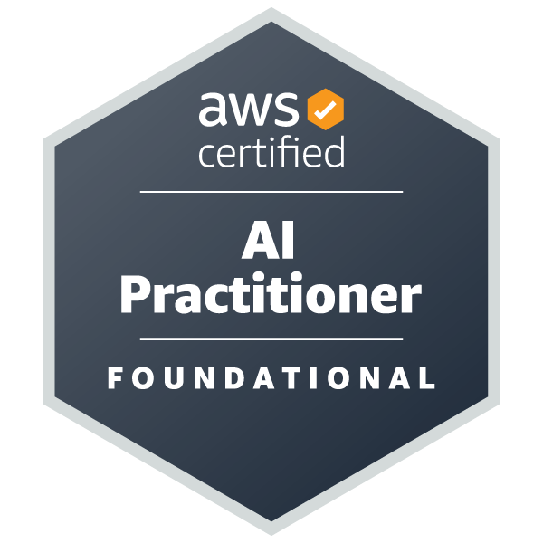

### Turning ideas into practical technology.

**AI Engineer** · Computer & Data Engineering Graduate  
📍 Hong Kong · 🌱 Exploring Node.js

 

 

<table>
<tr>
<td width="58%" valign="top">

## ✦ A little about me

I’m Steven, a Computer and Data Engineering graduate based in Hong Kong. I enjoy exploring how software, data, and AI can come together to solve real-world problems.

FOCUS     AI · Machine Learning · Software
BUILD     Practical tools and useful projects
LEARNING  Node.js and what comes next
</td>
<td width="42%" valign="top">

✦ Current chapter
🌱 Learning Node.js
🧠 Exploring AI & machine learning
☁️ Building with Python & cloud tools
🤝 Open to interesting collaborations
</td>
</tr>
</table>

◈ The toolkit

	
LANGUAGES
	AI / ML

CLOUD / DEV
	DESIGN / HARDWARE

◈ Credentials

&nbsp;&nbsp;&nbsp;&nbsp;

AWS Certified AI Practitioner   ·   AWS Certified Cloud Practitioner

<a href="https://www.credly.com/badges/107757e2-4d51-44d1-b447-7252db3deebb/linked_in?t=t4cj23">AI Practitioner credential ↗</a>
  ·  
<a href="https://www.credly.com/badges/9b5ef6e4-5dce-444e-959a-b136bc73bd0a">Cloud Practitioner credential ↗</a>

◈ GitHub, lately

Have an idea in mind?
I’m always glad to meet curious people, swap ideas, and build something useful together.
<a href="mailto:sintsun01@gmail.com">EMAIL</a>
  ·  
<a href="https://www.linkedin.com/in/sin-tsun-tang-291676268/">LINKEDIN</a>
  ·  
<a href="https://www.instagram.com/sintsun01">INSTAGRAM</a>
  ·  
<a href="https://sintsun.github.io/SintsunWebsite/">PORTFOLIO</a>

✦   Learn continuously. Build with purpose.   ✦

